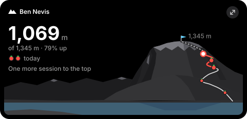
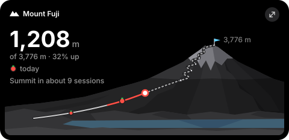
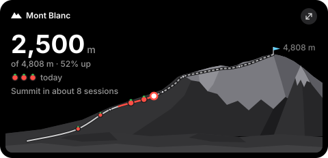
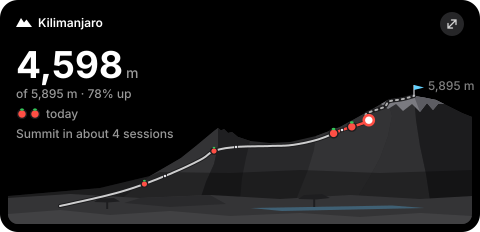
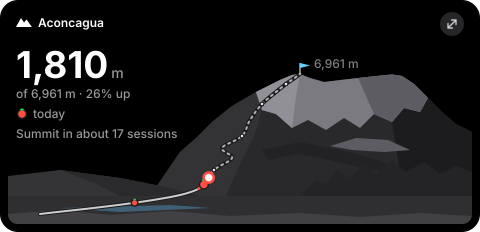
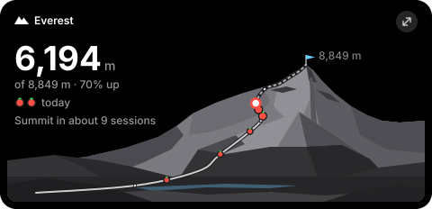
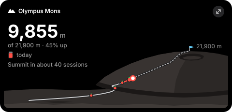
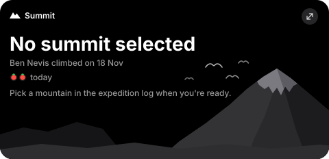

# The Summit widget's mountains

The Summit widget shows the peak you are climbing as a flat, faceted picture
that fills the whole tile, with your trail drawn on it. There are seven peaks,
and you pick the one to climb in the expedition log, in any order. Each was
drawn against a photograph of its best-known view, at close to its real
proportions, and its trail follows a real route where that view can show one.

The drawings below are the widget at its real size, 480 × 232 points, with
sample numbers. Beside each is the photograph it was drawn from.

## How they are drawn

- **Flat planes, no gradients.** Each mountain is a handful of broad planes in
  greys, lit from one side, with a snow cap and one or two details of its own.
- **One picture.** The landscape runs across the whole tile and the numbers sit
  in its sky. Droppy's card corner clips it.
- **A real route.** The trail is a smooth line from the foot to the summit.
  How high the climber stands in the picture is how far up the peak you are.
- **Nothing under 12 points.** The height beside the flag is the smallest text.

## The seven peaks

### 1. Ben Nevis, 1,345 m

Seen across Loch Linnhe from Corpach. The trail is the Mountain Track, which
climbs the right-hand flank from the Fort William side.

| Widget | Reference |
| --- | --- |
|  |  |

Photo: [Ben Nevis from Corpach](https://commons.wikimedia.org/wiki/File:Ben_Nevis_from_Corpach_-_geograph.org.uk_-_3477518.jpg)
by Steve Fareham, [CC BY-SA 2.0](https://creativecommons.org/licenses/by-sa/2.0).

### 2. Mount Fuji, 3,776 m

Seen from the north, over Lake Kawaguchi. The trail is the Yoshida Trail: up
through the forest to the fifth station at the tree line, then switchbacks
past the huts to the crater rim and round it to Kengamine, the highest point.
The slopes follow the mountain's real angles, with heights stretched by about
a fifth.

| Widget | Reference |
| --- | --- |
|  |  |

Photo: [Mount Fuji from Lake Kawaguchi](https://commons.wikimedia.org/wiki/File:Mount_Fuji_from_Lake_Kawaguchi_20170206.jpg)
by Suicasmo, [CC BY-SA 4.0](https://creativecommons.org/licenses/by-sa/4.0).

### 3. Mont Blanc, 4,808 m

Seen from the west, from Combloux. The trail is the Goûter Route: Nid d'Aigle,
the Tête Rousse hut, the Goûter hut, over the Dôme du Goûter, past the Vallot
hut and along the Bosses ridge. The sharp peak in front on the right is the
Aiguille de Bionnassay.

| Widget | Reference |
| --- | --- |
|  |  |

Photo: [Mont Blanc @ Combloux](https://commons.wikimedia.org/wiki/File:Mont_Blanc_@_Combloux.jpg)
by Rémih, [CC BY-SA 4.0](https://creativecommons.org/licenses/by-sa/4.0).

### 4. Kilimanjaro, 5,895 m

Seen from the north, from Amboseli: Mawenzi on the left, the broad dome of
Kibo on the right. The trail is the Rongai Route, the one that climbs this
side: past Mawenzi Tarn, across the Saddle to Kibo Hut, up to Gilman's Point
and along the rim to Uhuru Peak. Mawenzi is drawn lower than its true height
beside Kibo, as it looks from here.

| Widget | Reference |
| --- | --- |
|  |  |

Photo: [Kilimanjaro from Amboseli](https://commons.wikimedia.org/wiki/File:Kilimanjaro_from_Amboseli.jpg)
by Sergey Pesterev, [CC BY-SA 4.0](https://creativecommons.org/licenses/by-sa/4.0).

### 5. Aconcagua, 6,961 m

The south face, seen from the Horcones valley, with the Horcones lagoon in
front. The Normal Route climbs the far, north-western side, which this view
cannot show, so the trail is drawn up the left skyline in its place, with the
camps of the real route along it.

| Widget | Reference |
| --- | --- |
|  |  |

Photo: [Aconcagua south face, 1997](https://commons.wikimedia.org/wiki/File:AconcaguaSouthface1997.jpg)
by Albert Backer, [CC BY-SA 3.0](https://creativecommons.org/licenses/by-sa/3.0).

### 6. Everest, 8,849 m

The north face, seen from Rongbuk, with Changtse in front. The trail is the
North Col Route: base camp, round Changtse to the North Col, then up the north
ridge and along the left skyline to the summit.

| Widget | Reference |
| --- | --- |
|  |  |

Photo: [Everest North Face toward Base Camp, Tibet](https://commons.wikimedia.org/wiki/File:Everest_North_Face_toward_Base_Camp_Tibet_Luca_Galuzzi_2006.jpg)
by Luca Galuzzi (galuzzi.it), [CC BY-SA 2.5](https://creativecommons.org/licenses/by-sa/2.5).

### 7. Olympus Mons, 21,900 m

Seen from above the plains of Mars: a vast, low shield ringed by a scarp, with
its caldera at the top. The trail is invented, since nobody has climbed it
yet: up the scarp, then the long slope to the caldera rim. Its height is
stretched several times over; at true scale it would be almost flat.

| Widget | Reference |
| --- | --- |
|  |  |

Photo: [Olympus Mons, ESA Mars Express](https://commons.wikimedia.org/wiki/File:Olympus_Mons_-_ESA_Mars_Express_-_Flickr_-_Andrea_Luck.png)
by ESA/DLR/FU Berlin/Andrea Luck, [CC BY 2.0](https://creativecommons.org/licenses/by/2.0).

## With no climb under way

Until you pick a mountain, and again once you reach a top, the widget shows no
peak in particular: one generic mountain in the same greys, low in the corner,
a few gulls in the sky, and a line pointing to the expedition log. It has no
reference photograph. Its shapes are written straight into
[EmptySky.swift](../../Sources/Pomodorolog/Surfaces/EmptySky.swift), not
generated; this preview was drawn from the same numbers.



## The photographs

The reference photographs are not part of this repository. They are shown here
from Wikimedia Commons, each under the licence named beside it, and belong to
their authors. The drawings are original and are covered by this repository's
licence.

## Changing a mountain

The drawings are data, in [generator/gen.py](generator/gen.py): each peak is a
list of flat planes from the back to the front, the waypoints of its trail and
the huts along it. Mount Fuji is the exception; it was drawn by hand in
[generator/fuji.svg](generator/fuji.svg).

1. Edit the peak in `gen.py` (or `fuji.svg`).
2. Redraw the previews in this folder:

   ```bash
   python3 docs/summit/generator/gen.py
   ```

3. Write the same data into the widget:

   ```bash
   python3 docs/summit/generator/export_swift.py
   ```

That last step rewrites `Sources/Pomodorolog/Surfaces/PeakScenes.swift`, which
is generated and should not be edited by hand. Then build and check the shots
as usual.
